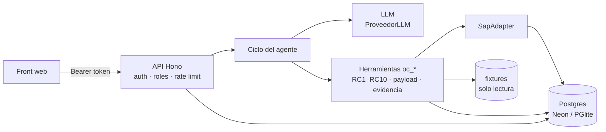

# Agente conversacional "Órdenes de Compra SAP"

[](https://github.com/gutiego/agente-ordenes-compra-sap/actions/workflows/ci.yml)

Agente de chat que lee el paquete de una solicitud de compra (solicitud, cotización, aprobación y, si existe, factura), lo valida contra los maestros con los controles RC1–RC10, construye la OC, genera la evidencia de aprobación y crea la OC en un SAP simulado. Las excepciones se devuelven a la analista con una recomendación y nada se crea sin su confirmación explícita.

Incluye autenticación con roles, persistencia en Postgres, control de concurrencia, pruebas automatizadas y CI/CD. Detalle y decisiones en [SOLUCION.md](SOLUCION.md) y [docs/decisiones.md](docs/decisiones.md).

## Arquitectura



## Levantar en local

Requisitos: Node 22 o superior.

```bash
cp .env.example .env      # define AUTH_TOKENS y, para el chat, ANTHROPIC_API_KEY
npm install
npm start                 # http://localhost:3000 → ingresa con un token de AUTH_TOKENS
```

Sin `DATABASE_URL` usa PGlite en `./data` (Postgres local, sin instalar nada). Sin `ANTHROPIC_API_KEY` el servidor arranca y el chat avisa que falta el modelo.

## Pruebas y calidad

```bash
npm test               # pruebas con aserciones (node:test): unitarias, API, concurrencia, persistencia
npm run test:coverage  # con cobertura
npm run lint           # Biome
npm run typecheck      # tsc --noEmit
npm run check          # las tres anteriores
npm run demo           # recorre los 6 casos sin modelo de lenguaje (PGlite en memoria)
```

La CI (GitHub Actions) ejecuta typecheck, lint, tests con cobertura, demo y `npm audit` en Node 22 y 24 en cada push y PR. Render solo despliega cuando la CI pasa.

## Variables de entorno

| Variable | Obligatoria | Descripción |
|---|---|---|
| `AUTH_TOKENS` | sí | JSON `{"<token>": {"usuario": "...", "rol": "analista" \| "auditor"}}`. Tokens de ≥ 16 caracteres. |
| `DATABASE_URL` | en producción | Postgres (Neon). Si falta, PGlite local. |
| `PGLITE_DIR` | no | Directorio de PGlite (`data`). |
| `ANTHROPIC_API_KEY` | para el chat | Solo vive en el backend; no aparece en front, logs ni respuestas. |
| `LLM_MODEL` | no | `claude-opus-5-5`. |
| `LLM_TIMEOUT_MS` | no | Timeout por llamada al modelo (60000). |
| `MAX_ITERACIONES` | no | Tope de iteraciones herramienta → modelo por turno (25). |
| `MAX_TOKENS_SESION` | no | Tope de tokens por sesión (400000). |
| `LIMITE_CHAT_MINUTO` | no | Mensajes de chat por usuario y minuto (20). |
| `PORT` | no | Puerto HTTP (3000). |

## API

Todas las rutas `/api/*` salvo `/api/health` exigen `Authorization: Bearer <token>`.

| Método | Ruta | Rol | Descripción |
|---|---|---|---|
| `GET` | `/api/health` | público | Estado del servicio y de la base (503 si la base no responde). |
| `GET` | `/api/me` | cualquiera | Usuario y rol del token. |
| `POST` | `/api/chat` | analista | `{ sessionId?, message }` → `{ sessionId, reply, toolCalls[], needsConfirmation, error? }` |
| `GET` | `/api/sessions/:id` | analista (dueño) | Historial de la sesión. |
| `GET` | `/api/control` | analista, auditor | Log de control: un registro por intento de creación. |
| `GET` | `/api/ordenes` | analista, auditor | OC creadas en el SAP simulado. |
| `GET` | `/api/evidencias/:solicitud/aprobacion.(txt\|pdf)` | analista, auditor | Evidencia de aprobación con su sha256. |

Respuestas de error: 400 entrada inválida · 401 sin token · 403 rol · 404 no existe o es de otro usuario · 409 sesión ocupada · 413 cuerpo > 32 KB · 429 rate limit · 500 con `requestId`.

```bash
TOKEN=...   # token de analista
curl -s -X POST localhost:3000/api/chat -H "Authorization: Bearer $TOKEN" -H "Content-Type: application/json" \
  -d '{"sessionId":"demo-0001","message":"Procesa la solicitud \"sol-004\" y no la crees hasta que yo lo confirme."}'
curl -s -X POST localhost:3000/api/chat -H "Authorization: Bearer $TOKEN" -H "Content-Type: application/json" \
  -d '{"sessionId":"demo-0001","message":"confirmo"}'
```

## Estructura

```
agent/prompt.md            comportamiento (system prompt)
src/knowledge/             conocimiento: ordenes-compra.md + reglas-oc.json (umbrales configurables)
src/tools/oc.ts            herramientas (cada export → oc_<export>)
src/tools/*.ts             helpers: paquete, maestros, controles, payload, evidencia, control, flujo
src/sap/                   interfaz SapAdapter y SAP simulado sobre Postgres
src/db/                    acceso a datos (pg / PGlite) y migraciones
src/agent/, src/llm/       ciclo del agente, sesiones, adaptador LLM
src/auth.ts                autenticación, roles y rate limit
src/app.ts, src/server.ts  API HTTP (crearApp, testeable) y arranque
web/                       front de chat
test/                      pruebas (unit, api, integración)
docs/decisiones.md         decisiones de arquitectura (ADR)
modulo/                    el agente empaquetado como módulo reutilizable (npm run modulo)
```
