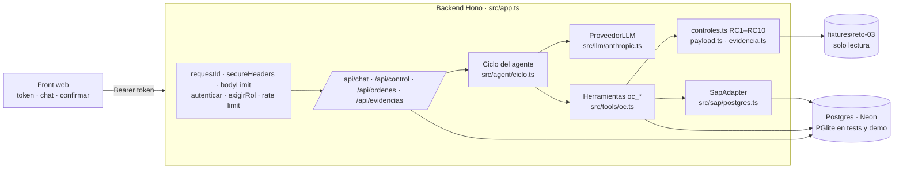

# SOLUCIÓN · Reto 03 · Agente "Órdenes de Compra SAP"

## 1. Problema en una frase

La analista administrativa digita a mano en SAP cada orden de compra y verifica de memoria que proveedor, centro de costo, aprobador y montos cuadren. Les duele a ella (tiempo y errores), a contabilidad (errores que se corrigen en el cierre) y a la dirección, que no sabe cuántas OC se crean después de la factura.

## 2. Arquitectura

- **Comportamiento**: `agent/prompt.md`, que se carga al arrancar.
- **Conocimiento**: `src/knowledge/ordenes-compra.md` se concatena al prompt. Los umbrales configurables están en `src/knowledge/reglas-oc.json`: tolerancia del 2 %, ±1, sociedad 1000, número inicial de OC, texto breve de 40 caracteres y patrones de unidad.
- **Ejecución**: `src/tools/oc.ts` contiene las 5 herramientas. Los helpers puros están en archivos aparte, porque solo los exports de `oc.ts` son herramientas.
- **Estado**: todo en Postgres (OC, log de control, evidencias, sesiones, trazas de herramientas). El disco solo se lee (fixtures, prompt).

Cambiar una regla de negocio toca `reglas-oc.json` o `controles.ts`, nunca el servidor.

## 3. Ciclo del agente

- **Bucle**: mensaje del usuario → `ProveedorLLM.enviar(mensajes, herramientas, sistema)` → si hay `tool_use`, ejecuta cada herramienta con `ejecutarHerramienta` (valida los argumentos con zod, nunca lanza y registra en `log_herramientas`) → devuelve los resultados al modelo → repite.
- **Tope (CA1)**: máximo `MAX_ITERACIONES` (25) llamadas al modelo por turno. Al alcanzarlo responde, sin otra llamada, con la lista de lo que hizo. También hay tope de tokens por sesión (`MAX_TOKENS_SESION`) y timeout por llamada (`LLM_TIMEOUT_MS`).
- **Confirmación humana (CA3), doble candado**: un turno queda "esperando confirmación" si alguna herramienta devolvió `pide_confirmacion: true` o si el texto termina en una pregunta de confirmación. En el siguiente mensaje **el servidor** calcula `ctx.confirmacionHumana`: es `true` solo si el turno anterior pidió confirmación y el mensaje la da ("confirmo", "sí"…; una negación siempre gana). `oc_crear` exige `confirmado: true` **y** que `ctx.confirmacionHumana` no sea `false`: el modelo no puede autoconfirmarse. `confirmado_por` registra el **usuario autenticado**.
- **Errores (CA5)**: los errores del proveedor (clave, rate limit, timeout, conexión) se traducen a lenguaje claro y la sesión sigue viva.

## 4. Elección del modelo

- **Proveedor y modelo**: Anthropic `claude-opus-5-5`, con `effort: medium` y el fallback server-side activado (`server-side-fallback-2026-07-01`), que reintenta en otro modelo si hay un rechazo por política.
- **Por qué**: sigue bien el uso de herramientas en varios pasos, respeta reglas del tipo "no afirmes valores que no salieron de una herramienta" y redacta en español con tablas. El proveedor está detrás de la interfaz `ProveedorLLM`: cambiarlo no toca el ciclo ni las herramientas (los tests usan un LLM falso con la misma interfaz).
- **Costo observado**: con `sol-004`, el primer turno hizo 4 llamadas a herramientas (~29,8 k tokens) y el turno "confirmo" 1 llamada (~20,8 k). Unos **50,7 k tokens por caso**: suponiendo ~90 % de entrada, ≈ 45,6 k × $4/M + 5,1 k × $20/M ≈ **US$ 0,28 por caso**. Con prompt caching del system prompt y las herramientas bajaría a menos de la mitad.

## 5. Matriz de controles

| # | Implementación (`src/tools/controles.ts`) | Tipo | Caso que lo ejercita |
|---|---|---|---|
| RC1 | `buscarProveedor`: busca por NIT normalizado (sin puntos ni DV). Si no hay NIT, compara el nombre normalizado. Inexistente o inactivo → bloqueo con acción para Datos Maestros. En `oc_crear` se vuelve a consultar con `SapAdapter.consultarProveedor`. | Bloqueo | sol-002 (inexistente), sol-006 (por nombre) |
| RC2 | La aprobación existe, el cuerpo contiene la palabra `aprobado` (configurable) y `de` está entre los aprobadores del centro. Si no, el bloqueo lista los aprobadores válidos. | Bloqueo | sol-003 |
| RC3 | `valor_total` ≤ tope del aprobador. Si el aprobador no es del centro, se compara con el **tope máximo del centro**, para reportar todas las razones a la vez. | Bloqueo | sol-003 (74 M > 30 M) |
| RC4 | El centro de costo existe y la subárea pertenece a él. | Bloqueo | todos |
| RC5 | `|cot − sol| / sol` > 2 % → confirmación con los dos valores, la diferencia y el porcentaje. La OC se crea por el valor de la solicitud. | Confirmación | sol-004 (6,00 %) |
| RC6 | Sin `indicador_iva` → se deriva el del proveedor, se registra como derivado y pide confirmación. | Confirmación + derivado | sol-006 |
| RC7 | Sin `condiciones_pago` → se derivan del proveedor. Solo se informa. | Derivado | sol-006 |
| RC8 | Factura con `fecha` < `fecha_solicitud` → `retroactiva = true`, confirmación y marca en el log de control. | Confirmación | sol-005 |
| RC9 | Fecha de la aprobación anterior a `fecha_solicitud` → confirmación. | Confirmación | tests (paquete modificado) |
| RC10 | `|cantidad × valor_unitario − valor_total|` > 1 → bloqueo. | Bloqueo | tests (paquete modificado) |

| Caso | Resultado |
|---|---|
| sol-001 | OC 4500000001 sin intervención; al repetirlo, el mismo número (idempotente). |
| sol-002 | Bloqueo RC1. |
| sol-003 | Bloqueos RC2 + RC3. |
| sol-004 | Confirmación RC5: 25.000.000 vs 26.500.000. |
| sol-005 | Confirmación RC8, retroactiva. |
| sol-006 | Confirmación RC6 y derivados de proveedor, IVA y condiciones. |

**El más difícil fue RC3 en sol-003.** El PRD define el tope "del aprobador para ese centro", pero en sol-003 el aprobador **no es** del centro. Si solo se reportara RC2, la analista conseguiría la aprobación correcta y volvería a quedar bloqueada porque 74 M supera el tope de 30 M. Por eso RC3 compara contra el tope máximo del centro y la respuesta trae las dos razones con sus acciones. El segundo más delicado fue RC5: pedir confirmación sin "arreglar" nunca el monto.

## 6. Listo para producción: autenticación, concurrencia, persistencia y CI/CD

Aunque el PRD los deja fuera del alcance obligatorio, un agente que **crea documentos contables** no debería desplegarse sin ellos.

### Autenticación y autorización (`src/auth.ts`)
- `Authorization: Bearer <token>` en toda la API salvo `/api/health`. Los tokens llegan por la variable `AUTH_TOKENS` y en memoria solo se guarda su sha256; la comparación usa `timingSafeEqual` y recorre todos los tokens para no filtrar información por tiempo.
- **Roles**: `analista` (chat, confirmar, crear OC) y `auditor` (solo lectura de `/api/control`, `/api/ordenes` y evidencias). 401 sin token o inválido; 403 por rol.
- Cada sesión de chat pertenece a su usuario: otra persona recibe 404 aunque conozca el id.
- El usuario real queda en `confirmado_por`, en el log de control y en las trazas.
- En producción: los tokens se reemplazan por OIDC/SSO del cliente (Entra ID). El middleware es el único punto que cambia.

### Concurrencia
| Riesgo | Solución | Prueba |
|---|---|---|
| Dos solicitudes simultáneas del mismo caso crean dos OC | `pg_advisory_xact_lock` por `solicitud_id` + `UNIQUE(solicitud_id)` con `ON CONFLICT DO NOTHING` como red de seguridad | 10 `oc_crear` en paralelo → 1 OC |
| Dos OC distintas reciben el mismo número | `SEQUENCE` de Postgres (atómica) | casos distintos en paralelo → números únicos |
| Dos mensajes simultáneos en la misma sesión corrompen el historial | *Lease* en la fila de la sesión (`UPDATE … WHERE ocupada_hasta < now()`), válido entre varias instancias y sin transacciones abiertas durante la llamada al LLM; caduca solo si el proceso muere | 409 en el segundo mensaje |
| Dos instancias migran a la vez | Lock global de migración | — |

### Persistencia (`src/db/`)
- **Postgres en Neon** en producción (TLS con `sslmode=verify-full`). **PGlite** (Postgres en WASM, en proceso) en tests, CI y demo: **el mismo SQL**, sin servicios externos ni claves en la CI.
- Migraciones versionadas (`schema_migrations`); transacciones en las escrituras compuestas; cierre ordenado del pool al recibir SIGTERM.
- Tablas: `ordenes` (SAP simulado), `control` (una fila por intento, solo inserciones), `evidencias` (contenido canónico, sha256 y PDF), `sesiones`, `log_herramientas`.

### Seguridad de la API (`src/app.ts`)
Cabeceras de seguridad (`secureHeaders`), límite de 32 KB por cuerpo, sin CORS (mismo origen), rate limit por usuario en el chat (429), manejador de errores que nunca devuelve el stack (solo un `requestId` para cruzar con el log), logs JSON estructurados por petición, y validación zod de todas las entradas (API y herramientas).

### Pruebas y CI/CD
- `npm test`: pruebas con aserciones sobre `node:test` (unitarias de RC1–RC10 y parsers; funcionales de la API con 401/403/404/409/413/429; flujo de chat con un LLM falso, incluida la confirmación; concurrencia; persistencia al reabrir la base). Ver `test/`.
- GitHub Actions (`.github/workflows/ci.yml`) en cada push y PR, en Node 22 y 24: `npm ci` → typecheck → lint (Biome) → tests con cobertura → demo → `npm audit`. Dependabot semanal.
- Render despliega **solo cuando la CI pasa** (`autoDeployTrigger: checksPass`) y usa `/api/health`, que comprueba la base.

## 7. Diseño del adaptador SAP real

**Opción elegida**: OData V2 `API_PURCHASEORDER_PROCESS_SRV` (S/4HANA), expuesto a través de **SAP Integration Suite** o de SAP API Management si el cliente lo tiene.

- Es la API pública, estable y documentada para crear OC. Valida igual que la transacción ME21N, devuelve el número de OC y no requiere conectores nativos en el agente.
- Con viabilidad no confirmada, OData es lo que Basis habilita más rápido (Communication Arrangement SAP_COM_0053 con un usuario técnico).
- `BAPI_PO_CREATE1` por RFC queda como alternativa si el sistema es ECC sin Gateway (exige SAP NW RFC SDK y `BAPI_TRANSACTION_COMMIT`).

**Mapeo** del payload de 7.4 a `A_PurchaseOrder` (deep insert a `to_PurchaseOrderItem` y `to_AccountAssignment`):

| Payload (7.4) | OData |
|---|---|
| `sociedad` | `CompanyCode` |
| `organizacion_compras` | `PurchasingOrganization` (+ `PurchasingGroup` por configuración) |
| `proveedor.codigo_sap` | `Supplier` |
| `moneda` | `DocumentCurrency` |
| `condiciones_pago` | `PaymentTerms` |
| `referencia.solicitud_id` | `CorrespncExternalReference` (o un campo Z), clave de idempotencia |
| `posiciones[].numero` | `PurchaseOrderItem` |
| `descripcion` | `PurchaseOrderItemText` (40) |
| `cantidad` / `unidad` | `OrderQuantity` / `PurchaseOrderQuantityUnit` (UN→`EA`/`ST`, H→`H`, MES→`MON` según T006) |
| `precio_unitario` | `NetPriceAmount`, convertido a neto según la política fiscal acordada |
| `indicador_iva` | `TaxCode` |
| `centro_costo` | `AccountAssignmentCategory = K` + `to_AccountAssignment.CostCenter` |
| `subarea` | campo de imputación o `GLAccount` según el mapeo de contabilidad |
| aprobador y excepciones | textos de cabecera (`to_PurchaseOrderNote`) |
| evidencia PDF | adjunto por `API_CV_ATTACHMENT_SRV` (GOS) con el sha256 en la descripción |

**Credenciales**: OAuth 2.0 client credentials (o X.509) con un usuario técnico de mínimo privilegio, que solo crea OC en la sociedad 1000. Viven en el gestor de secretos del backend y se inyectan en `SapODataAdapter`, otra implementación de `SapAdapter`. El modelo, el prompt y el front nunca las ven.

**Idempotencia y errores parciales**: antes de crear se consulta por la referencia externa; la creación es **un solo deep insert**; ante timeout o 5xx se reintenta con backoff consultando primero por referencia (si la OC se creó y la respuesta se perdió, se devuelve el número existente); si falla solo el adjunto, el control marca `evidencia_pendiente` y el reintento solo sube el adjunto.

**Plan B (sin conexión)**: OC lista para pegar en ME21N o archivo de carga masiva (LSMW / "Import Purchase Orders"), y la analista registra el número por el chat. Es otra implementación de `SapAdapter`, sin tocar el agente.

## 8. Lectura del proceso: OC retroactivas

Una OC retroactiva no es un error de digitación: es una compra que se **comprometió sin control previo**. En sol-005 la factura es del 10 de agosto, la solicitud del 27 y la aprobación del 28; el líder escribe "ya llegó la factura, por favor crear la OC para poder radicarla". La OC deja de ser un control y se vuelve un trámite para pagar: se paga lo facturado y no lo negociado, y los topes se validan cuando el gasto ya es irreversible.

El agente aporta **medición**: cada intento queda en la tabla `control` con `retroactiva`, consultable por el rol auditor, así que la dirección puede ver el porcentaje de OC retroactivas por centro, proveedor y aprobador. Recomendación: medir 4–6 semanas como línea base y luego (1) no radicar facturas sin número de OC, (2) OC marco para gastos recurrentes y (3) que finanzas decida la política: tolerarlas con justificación o bloquearlas por umbral (cambiar RC8 de confirmación a bloqueo en `reglas-oc.json`).

## 9. Decisiones y trade-offs

Las decisiones de arquitectura con su alternativa descartada están en [`docs/decisiones.md`](docs/decisiones.md). Las de negocio:

1. **Las herramientas recalculan todo desde el caso (CA2)** en lugar de confiar en lo que envía el modelo. `oc_crear` compara el payload recibido con el recalculado (serialización canónica) y rechaza si difiere. Costo: releer archivos pequeños en cada llamada, despreciable.
2. **RC3 "extendido"** al tope máximo del centro cuando el aprobador no es del centro (ver §5).
3. **Evidencia con contenido canónico determinista**: su sha256 se calcula igual en `construir_payload` y en `generar_evidencia`. Hashear el PDF no sirve: pdf-lib incluye fechas de creación.
4. **Precio y cantidad de la OC = solicitud aprobada**, nunca la cotización; la diferencia viaja como excepción confirmada.

## 10. Supuestos

- Los fixtures se usan sin modificar (`fixtures/reto-03/...`).
- Montos de solicitud, cotización y topes en la misma moneda e **IVA incluido**.
- El NIT se compara sin puntos ni dígito de verificación (`900.555.111-2` ≡ `900555111`).
- La validez de la cotización (fecha + días) se informa, no se controla.
- RC9 compara solo fechas; la aprobación del mismo día es válida.
- Unidad: `H` si menciona horas, `MES` si dice mensual, `UN` en otro caso (sol-001: 120 licencias → `UN`).
- El texto breve se recorta a 40 caracteres en límite de palabra y sin conectores colgando; la trazabilidad deja la nota.
- Cada llamada a `oc_crear` agrega una fila al control, incluidas `pendiente_confirmacion`, `bloqueada`, `existente` y `rechazada`.
- La numeración de OC puede tener huecos si una transacción se revierte (igual que los rangos de SAP); nunca duplicados.

## 11. Cobertura

| Historia | Estado | Qué falta para producción |
|---|---|---|
| HU-1 Leer el paquete | Hecho | Leer .xlsx/.pdf/.eml reales. |
| HU-2 Validar | Hecho | Maestros de SAP en tiempo real. |
| HU-3 Payload | Hecho | OC de varias posiciones. |
| HU-4 Evidencia | Hecho (txt + pdf, en base) | Firma digital si auditoría la exige. |
| HU-5 Crear en SAP simulado | Hecho | Adaptador OData real (§7). |
| HU-6 Errores | Hecho | — |
| Auth, concurrencia, persistencia, CI/CD | Hecho (§6) | SSO corporativo; rate limit compartido entre instancias. |
| Link público | Hecho | https://agente-ordenes-compra-sap-r7u5.onrender.com (Render + Neon; se despliega solo cuando la CI pasa). |

## 12. Uso de IA

- **Claude Code (Claude Opus 5.5)**, con subagentes en paralelo (uno para persistencia y otro para pruebas y CI).
- **Cómo nos repartimos el trabajo**: las decisiones fueron mías y Claude me acompañó en la ejecución. Yo definí el alcance y las prioridades: qué controles de producción incluir (autenticación, concurrencia, persistencia, pruebas y CI), Neon como base de datos, trabajar con subagentes en paralelo, qué dejar fuera del alcance y dejar la base limpia para la evaluación. Claude propuso el diseño técnico, que yo aprobé, y escribió el código, las pruebas y la documentación. Yo verifiqué el resultado en producción.
- **Qué revisamos o descartamos**:
  - Se descartó que `oc_crear` aceptara el payload del modelo como fuente de verdad: se recalcula y se compara.
  - Se descartó ajustar el precio de la OC al de la cotización: se confirma, no se corrige.
  - Se descartó un lock de sesión con transacción abierta durante la llamada al LLM (retendría una conexión del pool hasta 60 s): se usa un *lease* con caducidad.
  - Se descartó buscar-y-luego-crear la OC en dos pasos (carrera entre ambos): es un único paso atómico bajo lock.
- Todo el código es TypeScript estricto sin `any` y pasa typecheck, lint y tests en la CI.

## 13. Riesgos de producción y mitigación

| Riesgo | Mitigación |
|---|---|
| La conexión a SAP no es viable a corto plazo. | Plan B de §7 detrás de la misma interfaz `SapAdapter`. |
| El modelo "arregla" montos o se autoconfirma. | Las herramientas recalculan desde la fuente y rechazan payloads distintos; `confirmacionHumana` la fija el servidor. Cubierto por tests. |
| Prompt injection en correos o cotizaciones. | Los controles son código determinista: ninguna instrucción del correo cambia una regla. |
| Maestros desactualizados. | En producción se leen de SAP o del IdP en tiempo real. |
| Correo de aprobación falsificado. | Validar DKIM/SPF en la ingesta o pasar a workflow con firma; el sha256 hace trazable cualquier alteración. |
| Costo del LLM sin control. | Topes de iteraciones, tokens y timeout; rate limit por usuario; solo usuarios autenticados. |
| Token filtrado. | Rotación por variable de entorno sin redesplegar código; en producción, SSO con expiración. |
| Datos personales en logs. | Las trazas guardan resúmenes, nunca claves ni tokens; retención limitada en producción. |
| Siguientes pasos no incluidos | Contenedor Docker, OpenTelemetry (trazas y métricas), pruebas e2e de navegador, gestor de secretos, rate limit compartido (Redis o la base). |
